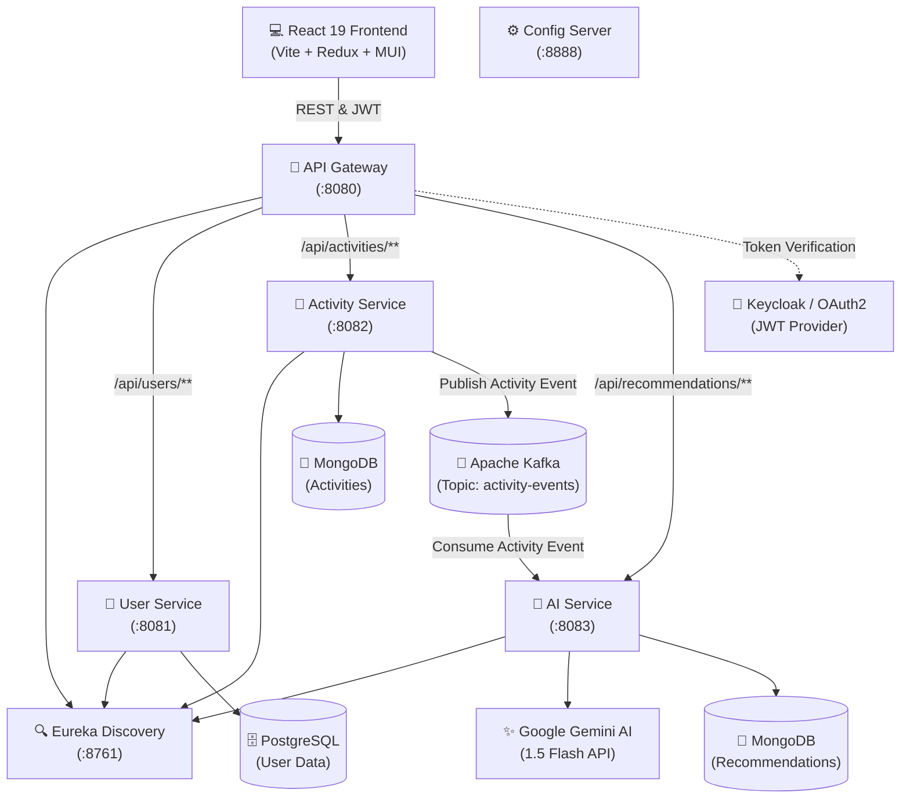

# 🏋️‍♂️ AI-Powered Fitness Tracker — Distributed Microservices Platform

[](https://spring.io/projects/spring-boot)
[](https://spring.io/projects/spring-cloud)
[](https://www.oracle.com/java/)
[](https://react.dev/)
[](https://vitejs.dev/)
[](https://kafka.apache.org/)
[](https://www.mongodb.com/)
[](https://www.postgresql.org/)
[](https://ai.google.dev/)

## 📖 About

**AI-Powered Fitness Tracker** is a production-grade, cloud-native fitness tracking platform built on a **distributed microservices architecture**. It combines real-time workout logging with intelligent AI coaching to help users train smarter, recover better, and stay injury-free.

### 🎯 The Problem
Traditional fitness apps offer static workout plans and generic advice. They don't adapt to *your* performance, don't analyze *your* workout patterns, and can't provide real-time, context-aware coaching — leaving users without the personalized guidance they need to progress safely.

### 💡 The Solution
This platform captures workout metrics in real-time, streams activity events through an **Apache Kafka** event-driven pipeline, and leverages **Google Gemini 1.5 Flash AI** to generate deeply personalized recommendations — including performance analysis, targeted improvements, dynamic next-workout plans, and injury-prevention guidance — all delivered asynchronously without blocking the user experience.

### 🔑 What Makes It Unique
- **Event-Driven AI Pipeline** — Workout data flows through Kafka to an AI consumer service, decoupling activity logging from recommendation generation for high throughput and resilience.
- **6 Independent Microservices** — Each service (User, Activity, AI, Gateway, Discovery, Config) is independently deployable, scalable, and maintainable.
- **On-Demand + Async AI** — Recommendations are generated both asynchronously via Kafka events *and* lazily on-demand if the async path is delayed, ensuring users always get insights.
- **Enterprise-Grade Security** — OAuth2 PKCE flow with Keycloak JWT authentication secures every API endpoint through a centralized gateway.
- **Modern Full-Stack** — React 19 + Vite frontend with Material-UI glassmorphic design, Redux Toolkit state management, and Axios interceptors for seamless auth integration.

---

## 🎬 Project Walkthrough

> A complete walkthrough demonstrating the application in action — from user authentication and workout logging to AI-powered recommendations.

<p align="center">
  <video src="https://github.com/Sahilkumbhar24/ai-fitness-app/raw/main/Project%20Walktrough.mp4" controls width="100%" poster="video-thumbnail.jpg">
  </video>
</p>

---

## 📑 Table of Contents

- [Project Walkthrough](#-project-walkthrough)
- [Architecture Overview](#-architecture-overview)
- [Key Features](#-key-features)
- [Tech Stack](#-tech-stack)
- [Microservices Breakdown](#-microservices-breakdown)
- [Event-Driven Flow](#-event-driven-flow)
- [Prerequisites](#-prerequisites)
- [Environment Configuration](#-environment-configuration)
- [Getting Started & Local Setup](#-getting-started--local-setup)
- [Docker & Containerization](#-docker--containerization)
- [API Documentation](#-api-documentation)
- [Frontend Architecture](#-frontend-architecture)
- [License](#-license)

---

## 🏗️ Architecture Overview

The system follows a decoupled, resilient microservices architecture orchestrated via service discovery, centralized configuration, and an API Gateway with an event-driven AI ingestion pipeline.



---

## ✨ Key Features

- **📊 Comprehensive Activity Logging:** Track activity type (Running, Cycling, Gym, Swimming, Yoga, etc.), duration, calories burned, and custom workout parameters.
- **⚡ Event-Driven AI Insights:** Asynchronous generation of AI workout assessments via Kafka messaging without blocking client transactions.
- **🧠 Personalized Gemini AI Coaching:**
  - **Performance Analysis:** In-depth evaluation of pace, cardio exertion, and metabolic burn efficiency.
  - **Targeted Improvements:** Actionable feedback tailored to endurance, form, and stamina.
  - **Dynamic Next Workout Plans:** Tailored follow-up training and active recovery suggestions.
  - **Safety & Injury Prevention:** Smart precautions based on intensity and duration.
- **🛡️ Secure Token-Based Authentication:** Protected endpoints using OAuth2 PKCE token exchange and Keycloak JWT authentication.
- **🎨 Glassmorphic & Modern UI:** Polished user interface built with React 19, Material-UI, theme customization, and Redux Toolkit state management.
- **🐳 Cloud-Ready & Containerized:** Multi-stage Docker build packaging all microservices into lightweight Alpine runtime containers.

---

## 🛠️ Tech Stack

### Backend & Cloud Services
- **Language & Runtime:** Java 17, Spring Boot 3.4.2
- **Cloud Components:** Spring Cloud 2024.0.0 (Netflix Eureka, Spring Cloud Gateway, Spring Cloud Config)
- **Message Broker:** Apache Kafka
- **Databases:** MongoDB (NoSQL for activities & AI recommendations), PostgreSQL (Relational for user profiles)
- **AI Integration:** Google Gemini 1.5 Flash via Spring WebFlux WebClient
- **Security:** Spring Security, OAuth2 Resource Server, JWT / Keycloak

### Frontend
- **Framework:** React 19 + Vite
- **UI & Icons:** Material-UI (MUI v9), Emotion Styled Components
- **State Management:** Redux Toolkit & React-Redux
- **Routing:** React Router v7
- **Authentication Client:** `react-oauth2-code-pkce`
- **HTTP Client:** Axios (with request interceptors for token & user headers)

---

## 🧩 Microservices Breakdown

| Service | Port | Description | Database / Tool |
| :--- | :--- | :--- | :--- |
| **`eureka`** | `8761` | Netflix Eureka Service Discovery & Registry | Standalone Registry |
| **`configserver`** | `8888` | Spring Cloud Centralized Configuration Server | Git / Native Config |
| **`gateway`** | `8080` | API Gateway, Route Matching & JWT Resource Server | Spring Cloud Gateway |
| **`userservice`** | `8081` | User Profiles & Account Management | PostgreSQL |
| **`activityservice`** | `8082` | Logs workout activities & emits Kafka events | MongoDB & Kafka Producer |
| **`aiservice`** | `8083` | Consumes workout events & queries Google Gemini AI | MongoDB & Kafka Consumer |
| **`fitness project`** | `5173` | Interactive Web Dashboard | React 19, Vite, MUI |

---

## 🔄 Event-Driven Flow

1. **User logs workout** on the frontend $\rightarrow$ POST request sent to API Gateway $\rightarrow$ routed to `activityservice`.
2. `activityservice` saves the activity record to **MongoDB** and publishes an `activity-events` message to **Apache Kafka**.
3. `aiservice` listens to `activity-events`, extracts the activity metadata (type, duration, calories, extra metrics), and structures an optimized prompt for **Google Gemini 1.5 Flash**.
4. The parsed AI response is structured into an actionable JSON recommendation (Analysis, Improvements, Next Workouts, Safety Guidelines) and persisted in MongoDB.
5. The frontend displays the workout log and queries `/api/recommendations/activity/{id}` to fetch or lazily generate insights on demand.

---

## 📋 Prerequisites

Ensure the following tools are installed on your machine:

- **JDK 17** or later
- **Node.js** (v18+ recommended) & **npm**
- **Apache Kafka** & **Zookeeper** (or Kafka KRaft)
- **MongoDB** (running on `localhost:27017`)
- **PostgreSQL** (running on `localhost:5432`)
- **Google Gemini API Key** (from [Google AI Studio](https://aistudio.google.com/))

---

## ⚙️ Environment Configuration

Set the following environment variables (or configure in `.env` / `application.properties`):

```bash
# Google Gemini API
GEMINI_API_KEY="your-gemini-api-key-here"

# MongoDB Database URIs
SPRING_DATA_MONGODB_URI="mongodb://localhost:27017/aiactivityfitness"
SPRING_DATA_MONGODB_DATABASE="aiactivityfitness"

# Kafka Broker
SPRING_KAFKA_BOOTSTRAP_SERVERS="localhost:9092"

# Eureka Discovery
EUREKA_CLIENT_SERVICEURL_DEFAULTZONE="http://localhost:8761/eureka/"

# PostgreSQL Configuration
SPRING_DATASOURCE_URL="jdbc:postgresql://localhost:5432/fitness-micro-user"
SPRING_DATASOURCE_USERNAME="postgres"
SPRING_DATASOURCE_PASSWORD="your_password"
```

---

## 🚀 Getting Started & Local Setup

### 1. Clone the Repository
```bash
git clone https://github.com/your-username/ai-fitness-app.git
cd ai-fitness-app
```

### 2. Start Infrastructure (Databases & Message Broker)
Ensure MongoDB, PostgreSQL, and Kafka are running:
```bash
# Example starting Kafka (KRaft mode)
bin/kafka-server-start.sh config/kraft/server.properties
```

### 3. Build & Run Backend Services

You can start the backend services in the following order:

```bash
# 1. Start Eureka Discovery
cd eureka
./mvnw spring-boot:run

# 2. Start Config Server (Optional/If enabled)
cd ../configserver
./mvnw spring-boot:run

# 3. Start Core Microservices
cd ../userservice
./mvnw spring-boot:run

cd ../activityservice
./mvnw spring-boot:run

cd ../aiservice
./mvnw spring-boot:run

# 4. Start API Gateway
cd ../gateway
./mvnw spring-boot:run
```

> **Tip:** You can check registered services on the Eureka Dashboard at `http://localhost:8761`.

### 4. Run Frontend

```bash
cd "fitness project"
npm install
npm run dev
```

The frontend application will start at **`http://localhost:5173`**.

---

## 🚀 Production Deployment

For detailed, step-by-step production deployment instructions, see the **[Complete Deployment Guide](DEPLOYMENT_GUIDE.md)**.

### Quick Deployment Options

| Platform | Type | Architecture | Cost | Guide |
| :--- | :--- | :--- | :--- | :--- |
| **Render** (Recommended) | Cloud PaaS | All-in-One Backend + Static Frontend + Managed DBs | Free tier | [Render Deployment Guide](DEPLOYMENT_GUIDE.md#-method-1-deploy-to-render-recommended-for-free-tier) |
| **Self-Hosted VM** | VPS (AWS EC2 / DigitalOcean) | Full Docker Compose (`docker-compose.prod.yml`) | ~$6–12/mo | [VM Deployment Guide](DEPLOYMENT_GUIDE.md#-method-2-self-hosted-on-any-cloud-vm-aws--digitalocean--hetzner) |
| **Multi-Service Cloud** | Render / Railway / Kubernetes | 8 Independent Containerized Services | Pay-per-service | [Multi-Service Guide](DEPLOYMENT_GUIDE.md#-method-3-multi-service-distributed-deploy-paid-render--railway) |

### 1-Click Render Deployment
This project includes a ready-to-use Render Blueprint:
1. Push your repository to GitHub.
2. In [Render](https://render.com), click **New +** → **Blueprint** and connect this repository.
3. Render reads `render.yaml` to provision PostgreSQL, Keycloak, the Spring Boot Backend, and the React frontend automatically.

---

## 🐳 Docker & Containerization

The repository includes a multi-stage `Dockerfile` and `start.sh` for production deployments:

```bash
# Build multi-service Docker image
docker build -t ai-fitness-app:latest .

# Run Docker container exposing the Gateway on port 8080
docker run -p 8080:8080 \
  -e GEMINI_API_KEY="your_api_key" \
  -e SPRING_DATA_MONGODB_URI="mongodb://host.docker.internal:27017" \
  -e SPRING_KAFKA_BOOTSTRAP_SERVERS="host.docker.internal:9092" \
  ai-fitness-app:latest
```

---

## 📡 API Documentation

All client API requests pass through the **API Gateway** on port `8080`.

### Activities API (`/api/activities`)
| Method | Endpoint | Description |
| :--- | :--- | :--- |
| `GET` | `/api/activities` | Get all logged activities for user |
| `POST` | `/api/activities` | Log a new workout activity |
| `GET` | `/api/activities/{id}` | Retrieve specific activity details |

### AI Recommendations API (`/api/recommendations`)
| Method | Endpoint | Description |
| :--- | :--- | :--- |
| `GET` | `/api/recommendations/user/{userId}` | Fetch all recommendations for a user |
| `GET` | `/api/recommendations/activity/{activityId}` | Fetch or lazily generate AI insight for an activity |
| `GET` | `/api/recommendations` | Get all historical recommendations |

### User Management API (`/api/users`)
| Method | Endpoint | Description |
| :--- | :--- | :--- |
| `GET` | `/api/users/{id}` | Get user profile |
| `POST` | `/api/users` | Register / sync user profile |

---

## 💻 Frontend Architecture

The frontend is modularized into reusable Material-UI components:

```
fitness project/src/
├── components/
│   ├── Navbar.jsx          # Header navigation, auth status & profile summary
│   ├── LandingHero.jsx     # Hero banner and welcome metrics
│   ├── ActivityForm.jsx    # Workout submission form with dynamic metric inputs
│   ├── ActivityList.jsx    # Live list of user activities & status badges
│   ├── ActivityDetail.jsx  # AI Insight modal/page with detailed breakdown
│   ├── StatsOverview.jsx   # Aggregated workout stats and calorie summaries
│   └── ActivityPage.jsx    # Main dashboard view
├── services/
│   └── api.js              # Axios instance with auth interceptors
├── store/                  # Redux slices for global state
├── authConfig.js           # Keycloak / OAuth2 PKCE configuration
└── theme.js                # Custom Material-UI dark/light theme
```

---

## 📄 License

This project is open source and available under the [MIT License](LICENSE).
